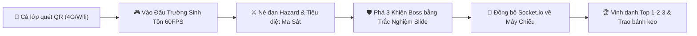

# 🎮 ĐẤU TRƯỜNG THẶNG DƯ (SURPLUS SURVIVOR)
### *Game Tương Tác Thuyết Trình Môn Kinh Tế Chính Trị Mác - Lênin (MLN122)*
**Học kỳ Spring 2026 – Lớp GD1906 – Đại học FPT TP.HCM**  
**Nhóm 1:** *Chủ đề "Vốn nhân lực hay Giá trị thặng dư tinh vi? Bản chất mô hình quản trị lấy con người làm trung tâm tại các tập đoàn Big Tech"*

---


---

## 📌 MỤC LỤC
1. [Giới Thiệu Dự Án](#-1-giới-thiệu-dự-án)
2. [Ý Tưởng Thiết Kế & Trải Nghiệm Lớp Học](#-2-ý-tưởng-thiết-kế--trải-nghiệm-lớp-học)
3. [Nội Dung Học Thuật 100% Chuẩn Slide MLN122](#-3-nội-dung-học-thuật-100-chuẩn-slide-mln122)
4. [Cơ Chế Gameplay & Hệ Thống Kỹ Năng 60FPS](#-4-cơ-chế-gameplay--hệ-thống-kỹ-năng-60fps)
5. [Kiến Trúc Đồ Họa & Âm Thanh Thủ Tục (Procedural Synth)](#-5-kiến-trúc-đồ-họa--âm-thanh-thủ-tục-procedural-synth)
6. [Giao Diện Admin & Màn Chiếu Lớp Học (Projector Mode)](#-6-giao-diện-admin--màn-chiếu-lớp-học-projector-mode)
7. [Cấu Trúc Thư Mục Dự Án](#-7-cấu-trúc-thư-mục-dự-án)
8. [Hướng Dẫn Cài Đặt & Chạy Nhanh Khi Đi Thuyết Trình](#-8-hướng-dẫn-cài-đặt--chạy-nhanh-khi-đi-thuyết-trình)
9. [Bộ Câu Hỏi & Đáp Án Giải Thích](#-9-bộ-câu-hỏi--đáp-án-giải-thích)
10. [Bản Quyền & Thông Tin Nhóm Thực Hiện](#-10-bản-quyền--thông-tin-nhóm-thực-hiện)

---

## 📖 1. GIỚI THIỆU DỰ ÁN

Thay vì tổ chức minigame Kahoot/Quizizz truyền thống chỉ bấm trắc nghiệm nhàm chán, **Đấu Trường Thặng Dư (Surplus Survivor)** là một tựa game **Action Arena / Bullet-Hell Survivor** thời gian thực (Real-time Multiplayer 60FPS) được thiết kế đặc thù cho buổi thuyết trình bảo vệ môn **Kinh tế Chính trị Mác - Lênin (MLN122)** tại Đại học FPT.

Trò chơi biến toàn bộ **18 slide thuyết trình** trừu tượng về lý luận *Giá trị thặng dư ($m$), Tư bản khả biến ($v$), Tư bản bất biến ($c$), Thời gian tất yếu ($t$), Thời gian thặng dư ($t'$), GTTD Tương đối, GTTD Siêu ngạch, và Bẫy lao động trẻ* thành các cơ chế chiến đấu sinh tồn kịch tính kéo dài đúng **5 phút**, giúp cả lớp vừa chơi hăng say, vừa khắc sâu kiến thức lý luận để nhận bánh kẹo.



---

## 💡 2. Ý TƯỞNG THIẾT KẾ & TRẢI NGHIỆM LỚP HỌC

- **Thời lượng:** Giới hạn chuẩn xác **5 phút** (300 giây) để khớp hoàn hảo với khung thời gian Q&A/Minigame của buổi thuyết trình.
- **Tiếp cận tức thì:** Không cần cài app, không đăng ký tài khoản. Sinh viên chỉ cần dùng Camera điện thoại hoặc Zalo quét mã QR trên máy chiếu là vào game ngay lập tức.
- **Vượt tường lửa FPT & mạng 4G:** Tích hợp sẵn công nghệ **Cloudflare Quick Tunnel** tự động sinh domain `https://*.trycloudflare.com` công khai, tương thích 100% với mạng 4G Viettel, Vina, Mobi lẫn Wi-Fi FPT University.
- **Màn hình Admin chuyên dụng cho máy chiếu:** Hiển thị đường đua 5 màn chơi thời gian thực, bảng xếp hạng Top 10 nhảy điểm liên tục, telemetry feed cập nhật hành vi người chơi và hiệu ứng pháo hoa vinh danh trao giải cuối giờ.

---

## 📚 3. NỘI DUNG HỌC THUẬT (100% CHUẨN SLIDE MLN122)

Toàn bộ 5 Tầng thử thách trong game được thiết kế tương ứng trực tiếp với từng phần trong Slide thuyết trình của Nhóm 1:

| Tầng | Tên Màn Chơi | Bám Sát Slide | Trùm Cuối (Boss) | Hiểm Họa Môi Trường (Hazard) & Bản Chất Lý Luận |
| :---: | :--- | :---: | :--- | :--- |
| **1** | **Mê Cung Phúc Lợi Big Tech** | *Slide 02 - 04* | **AI Quản Trị People Analytics** 👁️ | **Xe Shuttle Google phóng tốc độ cao:** Mô phỏng việc triệt tiêu "ma sát sinh hoạt" (ăn uống, đi lại) để tối đa hóa thời gian cống hiến cho công ty. |
| **2** | **Cối Xay Tư Bản C. Mác** | *Slide 05 - 06* | **Cỗ Máy Khai Thác Thặng Dư ($M$)** ⚙️ | **Vòng bo Tư bản Khả biến ($v$):** Vòng an toàn di chuyển liên tục; đứng ngoài sẽ bị mất máu. Minh họa bản chất: tiền lương ($v$) chỉ nuôi sống công nhân để tiếp tục tạo ra thặng dư ($m$). |
| **3** | **Lõi Độc Quyền Big Tech** | *Slide 07 - 09* | **Lõi Thuật Toán Độc Quyền 20%** 🤖 | **Bức tường nén Thời gian tất yếu ($t$):** 4 bức tường thu hẹp từ $4.0h$ xuống $1.2h$, minh họa phương pháp sản xuất GTTD Tương đối & Siêu ngạch qua chính sách 20% Time. |
| **4** | **Địa Ngục Hustle Culture** | *Slide 10 - 13* | **Chúa Tể Burnout & OT 24/7** 🔥 | **Hố đen OT Không Lương & Bão Email 0h:** Lực hút trọng lực kéo người chơi vào tâm; biểu thị phương pháp sản xuất GTTD Tuyệt đối mới và bẫy bóc lột thực tập sinh ($v=15\% / m=85\%$). |
| **5** | **Đấu Trường Toàn Cầu** | *Slide 14 - 16* | **Đại Đế Tư Bản Toàn Cầu** 👑 | **Tia Laser Quét 360° & Mưa đạn thất nghiệp 12.4%:** Yêu cầu người chơi vận dụng trọn vẹn Lộ trình 4 bước và Mục tiêu Phát triển Bền vững SDG 8 (Decent Work). |

---

## 🕹️ 4. CƠ CHẾ GAMEPLAY & HỆ THỐNG KỸ NĂNG 60FPS

Mỗi tầng bao gồm **2 giai đoạn (Phases)** đan xen nhịp nhàng giữa phản xạ hành động và tư duy học thuật:

```
[Giai đoạn 1: Dọn Quái & Tích Lũy Năng Lượng Thặng Dư (0 - 100%)]
                        │
                        ▼
[Giai đoạn 2: Trùm Giáng Lâm (3 Lớp Khiên Lục Giác Bất Hoại)]
                        │
       ┌────────────────┴────────────────┐
       ▼                                 ▼
[Trả Lời ĐÚNG (trong 12s)]        [Trả Lời SAI / HẾT GIỜ]
       │                                 │
  Phá vỡ 1 Khiên                    Boss CUỒNG NỘ (ENRAGE 6s)
  Trừ máu Boss                      Xả mưa đạn Bullet-Hell
  Cộng +500 Điểm thưởng            Người chơi phải né cật lực
       │                                 │
       └────────────────┬────────────────┘
                        ▼
   [Phá hủy đủ 3 Khiên ➔ VƯỢT TẦNG THÀNH CÔNG]
```

### 🎮 Hệ Thống Điều Khiển Linh Hoạt
- **Trên Điện Thoại (Mobile Web):**
  - Cần điều khiển ảo (Virtual Floating Joystick) mượt mà ở ngón tay trái.
  - Bộ 4 nút cảm ứng hành động ở ngón tay phải (Bắn/Auto-Aim, Dash, EMP, Overdrive).
  - Có thể chạm trực tiếp lên màn hình Canvas để di chuyển theo ngón tay (Touch Steering).
  - Khay trả lời câu hỏi tự động trượt lên (Bottom Sheet) to rõ, chống bấm nhầm khi đang thao tác.
- **Trên Máy Tính (Desktop Web):**
  - Di chuyển: Phím `W, A, S, D` hoặc `Phím Mũi Tên`.
  - Bắn đạn: `Chuột Trái` hoặc `Phím Space` (Tự động khóa mục tiêu gần nhất).
  - Kỹ năng Lướt (Dash): `Phím Shift` hoặc `Phím J`.
  - Kích hoạt Khiên EMP: `Phím E` hoặc `Phím K`.
  - Trạng thái Bộc Phá (Overdrive): `Phím R`.

### ⚡ Bộ Kỹ Năng Nhân Vật
1. **LƯỚT NHANH (DASH):**
   - Lướt nhanh trong $0.3$ giây với hiệu ứng bóng mờ (After-image trail).
   - **Bất tử hoàn toàn (Invulnerable I-Frames):** Cho phép lướt xuyên qua mọi làn đạn dày đặc và tia laser xoay 360°.
2. **XUNG ĐIỆN TỪ (EMP BLAST):**
   - Phóng luồng sóng xung kích năng lượng cao bán kính 300px.
   - Tiêu diệt **toàn bộ đạn đạo của địch** trên màn hình ngay tức khắc và làm choáng kẻ địch xung quanh trong $1.5$ giây.
3. **BỘC PHÁ (OVERDRIVE):**
   - Kích hoạt trạng thái siêu năng lượng trong $5$ giây: Tăng gấp đôi tốc độ xả đạn, mở rộng cỡ đạn plasma và bắn tỏa hình quạt 3 tia.

---

## 🎨 5. KIẾN TRÚC ĐỒ HỌA & ÂM THANH THỦ TỤC

Dự án áp dụng các kỹ thuật lập trình web hiện đại để đạt hiệu năng tối đa trên mọi dòng máy điện thoại của sinh viên:

### 🌟 Đồ Họa 60FPS Độc Lập (`graphics.js`)
- Render thuần bằng **HTML5 Canvas 2D Context** với kỹ thuật hòa trộn ánh sáng rực rỡ (`ctx.globalCompositeOperation = 'lighter'`).
- Không tải ảnh ngoài (`.png`, `.jpg` nặng nề) mà vẽ 100% bằng thuật toán toán học vector (Procedural Vector Sprites), giúp game tải trong **0.1 giây**.
- Hệ thống hạt phân rã (Particle Engine) xử lý đồng thời hơn **300 hạt neon**, tia lửa, mảnh kính vỡ và vòng sóng xung kích khi trùm nổ tung.
- Hiệu ứng camera rung chấn (Camera Shake) và chớp đỏ cảnh báo nguy hiểm (Vignette Flash) khi nhân vật bị trúng đạn.

### 🎵 Âm Thanh Thủ Tục Web Audio API (`audio.js`)
- Sử dụng **Web Audio API** tạo xung sóng âm thanh nguyên bản (Oscillators, GainNodes, BiquadFilters), **không cần bất kỳ file mp3 nào**:
  - **Lobby BGM:** Hợp âm Ambient synth nhẹ nhàng, tạo không khí háo hức chờ đợi.
  - **Wave BGM:** Tiếng bassline nhịp $130$ BPM sôi động, dồn dập kích thích phản xạ.
  - **Boss BGM:** Darksynth công nghiệp mạnh mẽ, trống dập uy lực.
  - **Enrage BGM:** Tiếng còi báo động kết hợp hiệu ứng méo tiếng (Distortion) khi trả lời sai câu hỏi.
  - **Victory Fanfare:** Khúc khải hoàn 4 hợp âm rộn rã khi chiến thắng.
- Tích hợp nút **Bật/Tắt Âm Thanh** góc trên màn hình để người chơi tùy biến theo sở thích.

---

## 🖥️ 6. GIAO DIỆN ADMIN & MÀN CHIẾU LỚP HỌC

Trang Admin (`http://localhost:3000/admin.html`) được tối ưu hóa đặc biệt cho **Máy chiếu phòng học FPT**:

```
┌────────────────────────────────────────────────────────────────────────┐
│ 🔴 TRẬN ĐẤU ĐANG DIỄN RA                         ⏱️ THỜI GIAN: 03:42   │
├──────────────────────────────────┬─────────────────────────────────────┤
│ 🏁 ĐƯỜNG ĐUA 5 TẦNG THỜI GIAN THỰC │ 🏆 BẢNG XẾP HẠNG TOP 10 REALTIME    │
│ [Tầng 1] 👤 Tuấn, 👤 Lan          │ 🥇 1. Nguyễn Văn A  - 4,250 pts     │
│ [Tầng 2] 👤 Minh, 👤 Hoàng        │ 🥈 2. Trần Thị B    - 3,800 pts     │
│ [Tầng 3] 👤 Mai                  │ 🥉 3. Lê Hoàng C    - 3,450 pts     │
│ [Tầng 4] 👤 Đức                  │    4. Phạm D        - 2,900 pts     │
│ [Tầng 5] 👤 An                   │    5. Vũ E          - 2,550 pts     │
├──────────────────────────────────┴─────────────────────────────────────┤
│ 📡 NHẬT KÝ CHIẾN ĐẤU (TELEMETRY LIVE FEED)                             │
│ 10:14:02 - [Nguyễn Văn A] Vừa phá vỡ Khiên 2 của Chúa Tể Burnout (+500)│
│ 10:14:05 - [Trần Thị B] Trả lời sai câu hỏi! Boss Cuồng Nộ!           │
└────────────────────────────────────────────────────────────────────────┘
```

- **Mã QR Toàn Màn Hình:** Bấm nút `📱 Phóng To QR Cả Lớp Quét` để hiện mã QR khổng lồ trên máy chiếu.
- **Quản lý thời gian linh hoạt:** Nút `⏱️ +30 Giây` bổ sung thời gian nếu thấy các bạn trong lớp đang đua tranh hấp dẫn.
- **Bục Vinh Danh Top 1 - 2 - 3:** Hiệu ứng bắn pháo hoa (Confetti) toàn màn hình cùng cúp vàng vinh danh những sinh viên xuất sắc nhất để trao bánh kẹo.
- **Xuất Kết Quả CSV:** Tải file `bang_diem_mln122.csv` ghi nhận đầy đủ họ tên, điểm số, tầng đã vượt qua và thời gian hoàn thành.

---

## 📂 7. CẤU TRÚC THƯ MỤC DỰ ÁN

```
MLN2/
├── .gitignore                      # Loại trừ node_modules và log thừa
├── package.json                    # Cấu hình dependency Express, Socket.io, untun
├── package-lock.json
├── server.js                       # Máy chủ Node.js, Socket.io, Cloudflare Tunnel
├── START_GAME.bat                  # File bấm 1-click để khởi động game khi thuyết trình
├── HD_SU_DUNG.md                   # Hướng dẫn nhanh cho người thuyết trình
├── README.md                       # Tài liệu kỹ thuật & nội dung chi tiết dự án
├── MLN122 - GROUP 1 - GIÁ TRỊ THẶNG DƯ.pdf  # Slide gốc của nhóm
│
├── data/
│   └── gameData.js                 # 5 Màn chơi, 15 câu hỏi bám sát 18 Slide & Avatars
│
└── public/
    ├── index.html                  # Giao diện người chơi (Mobile/Desktop 100dvh)
    ├── styles.css                  # Thiết kế giao diện Glassmorphism Cyberpunk
    ├── player.js                   # Logic động cơ trò chơi 60FPS phía client
    ├── graphics.js                 # Bộ dựng hình Canvas Vector 60FPS không tải ảnh
    ├── audio.js                    # Bộ phát nhạc & hiệu ứng âm thanh Web Audio API
    ├── admin.html                  # Giao diện máy chiếu và bảng điều khiển quản trị
    └── admin.js                    # Logic đồng bộ máy chiếu, đường đua, bục trao giải
```

---

## 🚀 8. HƯỚNG DẪN CÀI ĐẶT & CHẠY NHANH

### Cách 1: Khởi động 1-Click khi đi thuyết trình (Khuyên Dùng)
1. Cắm máy tính vào máy chiếu phòng học.
2. Bấm đúp chuột vào file **`START_GAME.bat`**.
3. Cửa sổ dòng lệnh sẽ tự khởi chạy server và trình duyệt tự động mở trang Quản trị:
   - Địa chỉ Admin: `http://localhost:3000/admin.html`
   - Mật khẩu đăng nhập Admin mặc định: **`group1`** *(Đã được cấu hình tự động điền)*.
4. Bấm **`📱 Phóng To QR Cả Lớp Quét`** cho cả lớp quét mã vào đấu trường.

### Cách 2: Khởi động qua Terminal
```bash
# 1. Cài đặt các gói phụ thuộc (nếu chưa có)
npm install

# 2. Khởi động server game
npm start
```

Sau khi khởi động, console sẽ hiển thị:
```
============================================================
  🎮 ĐẤU TRƯỜNG THẶNG DƯ - MLN122 (GROUP 1 - GD1906)
============================================================
  🌐 Local Server:     http://localhost:3000
  📡 Admin Panel:      http://localhost:3000/admin.html
  🔒 Admin Password:   group1
  🚀 Cloudflare Link:  https://your-tunnel-subdomain.trycloudflare.com
============================================================
```

---

## ❓ 9. BỘ CÂU HỎI & ĐÁP ÁN GIẢI THÍCH (15 CÂU)

Toàn bộ 15 câu hỏi được chia đều cho 5 tầng (mỗi tầng 3 câu), bám sát nội dung kiểm tra học phần:

### Tầng 1: Mê Cung Phúc Lợi Big Tech *(Slide 02 - 04)*
1. **Câu 1.1:** Doanh nghiệp chuyển từ gọi nhân viên là "Nguồn nhân lực" sang "Vốn nhân lực" nhằm mục đích gì?  
   👉 **Đáp án đúng:** Khẳng định đầu tư vào con người là yếu tố quyết định trực tiếp đến khả năng sinh lời và tạo thặng dư (*Slide 02*).
2. **Câu 1.2:** Tại Google, mạng lưới đào tạo nội bộ 'g2g' (>80%) kết hợp với 'People Analytics' mang lại lợi ích gì?  
   👉 **Đáp án đúng:** Dùng dữ liệu lớn tối ưu hiệu suất cá nhân và tiết kiệm tối đa chi phí thuê chuyên gia bên ngoài (*Slide 03 & 04*).
3. **Câu 1.3:** Vì sao phúc lợi văn phòng (3 bữa ăn, Shuttle bus, Gym) lại chuyển hóa trực tiếp thành tốc độ xử lý công việc?  
   👉 **Đáp án đúng:** Triệt tiêu ma sát sinh hoạt và biến cả thời gian nghỉ ngơi thành không gian thảo luận công việc (*Slide 04*).

### Tầng 2: Cối Xay Tư Bản C. Mác *(Slide 05 - 06)*
4. **Câu 2.1 (Tính toán):** Kỹ sư làm 8h/ngày, thời gian tất yếu $t = 2h$, thời gian thặng dư $t' = 6h$. Tỷ suất $m'$ là bao nhiêu?  
   👉 **Đáp án đúng:** $m' = \frac{t'}{t} \times 100\% = \frac{6}{2} \times 100\% = 300\%$ (*Slide 05*).
5. **Câu 2.2:** Dưới lớp vỏ ngôn từ nhân văn ("cộng sự", thưởng ESOP), bản chất thực sự của việc chi trả cho "Vốn nhân lực" là gì?  
   👉 **Đáp án đúng:** Đầu tư vào Tư bản khả biến ($v$) nhằm tái sản xuất sức lao động để khai thác giá trị thặng dư ($m$) gấp bội (*Slide 06*).
6. **Câu 2.3:** Trong công thức $M = m' \times V$, nếu vừa nâng cao trình độ bóc lột ($m'$) vừa mở rộng quỹ lương ($V$) thì điều gì xảy ra?  
   👉 **Đáp án đúng:** Khối lượng giá trị thặng dư ($M$) tăng lên theo cấp số nhân (*Slide 06*).

### Tầng 3: Lõi Độc Quyền Big Tech *(Slide 07 - 09)*
7. **Câu 3.1:** Khi Big Tech trang bị AI rút ngắn thời gian tất yếu $t$ từ $4.0h$ xuống $1.2h$ trong ngày làm việc 8h, đây là phương pháp nào?  
   👉 **Đáp án đúng:** Sản xuất Giá trị thặng dư tương đối — $m' = \frac{6.8}{1.2} \times 100\% \approx 566.7\%$ (*Slide 07*).
8. **Câu 3.2:** Hai yếu tố cốt lõi nào giúp Big Tech thu được "Giá trị thặng dư siêu ngạch" độc quyền vượt xa mức trung bình?  
   👉 **Đáp án đúng:** Tập hợp "Lao động phức tạp" kết hợp sản phẩm phần mềm có "Chi phí biên bằng 0" (*Slide 08*).
9. **Câu 3.3:** Gmail, AdSense và Google News đều ra đời từ chính sách "20% Time". Bản chất KTCT thực sự là gì?  
   👉 **Đáp án đúng:** Chiếm đoạt kết quả lao động sáng tạo ngoài nhiệm vụ chính và thâu tóm bản quyền sở hữu trí tuệ tỷ đô với chi phí R&D tối thiểu (*Slide 09*).

### Tầng 4: Địa Ngục Hustle Culture & Bẫy Giá Rẻ *(Slide 10 - 13)*
10. **Câu 4.1:** Phương pháp sản xuất GTTD Tuyệt đối mới vận hành qua 3 công cụ tinh vi nào?  
    👉 **Đáp án đúng:** Tiện ích khép kín giữ chân ở lại muộn + Kết nối đám mây/email 24/7 + Áp lực OKRs tự thân khiến nhân viên tự nguyện vắt sức (*Slide 10 & 11*).
11. **Câu 4.2:** Ở nhóm "Thực tập sinh bị lạm dụng", tỷ lệ thù lao nhận về ($v$) so với thặng dư doanh nghiệp thu ($m$) là bao nhiêu?  
    👉 **Đáp án đúng:** $v = 15\%$ và $m = 85\%$ (Khoảng cách bóc lột cực đại kèm danh xưng ảo) (*Slide 13*).
12. **Câu 4.3:** Đâu là thái độ đúng đắn theo phép biện chứng duy vật đối với thị trường lao động trẻ (Fresher, OJT, Gig)?  
    👉 **Đáp án đúng:** Nhìn nhận toàn diện hai mặt: Tận dụng mặt tích cực (đào tạo thực chiến, nâng cao lao động phức tạp) đồng thời tỉnh táo trước mặt trái (thực tập giá rẻ, Burnout) (*Slide 12 & 13*).

### Tầng 5: Đấu Trường Toàn Cầu *(Slide 14 - 16)*
13. **Câu 5.1:** Trước tỷ lệ thất nghiệp thanh niên toàn cầu 12,4%, chìa khóa tự bảo vệ cốt lõi của sinh viên là gì?  
    👉 **Đáp án đúng:** Nhận thức tạo thặng dư ($m$) là điều kiện để trả lương ($v$), từ đó rèn luyện năng lực hiếm (lao động phức tạp) để có vị thế đàm phán Win-Win (*Slide 14*).
14. **Câu 5.2:** Đâu là thứ tự chuẩn xác của "Lộ trình 4 bước hành động" tại Slide 15?  
    👉 **Đáp án đúng:** (I) Lao động phức tạp ➔ (II) Chọn đúng bệ phóng ➔ (III) Đàm phán công bằng ➔ (IV) Bảo vệ pháp lý & Quản trị năng lượng (*Slide 15*).
15. **Câu 5.3:** Thông điệp kết luận gắn với Mục tiêu Phát triển Bền vững nào của Liên Hợp Quốc (UN)?  
    👉 **Đáp án đúng:** SDG 8 (Target 8.2 & 8.5) — Tăng trưởng kinh tế phải đi đôi với Việc làm thỏa đáng (Decent Work) và tôn trọng phẩm giá con người (*Slide 16*).

---

## 👥 10. BẢN QUYỀN & THÔNG TIN NHÓM THỰC HIỆN

- **Môn học:** Kinh tế Chính trị Mác - Lênin (MLN122)
- **Đơn vị đào tạo:** Đại học FPT TP. Hồ Chí Minh
- **Lớp:** GD1906 – Học kỳ Spring 2026
- **Nhóm thực hiện:** Nhóm 1
- **Chủ đề nghiên cứu:** *"Vốn nhân lực hay Giá trị thặng dư tinh vi? Bản chất mô hình quản trị lấy con người làm trung tâm tại các tập đoàn Big Tech"*
- **Mã nguồn GitHub:** [https://github.com/chstrg2208/MLN2.git](https://github.com/chstrg2208/MLN2.git)

---
*Chúc Nhóm 1 có một buổi thuyết trình rực rỡ, cuốn hút và đạt điểm số tối đa! 🎉*
